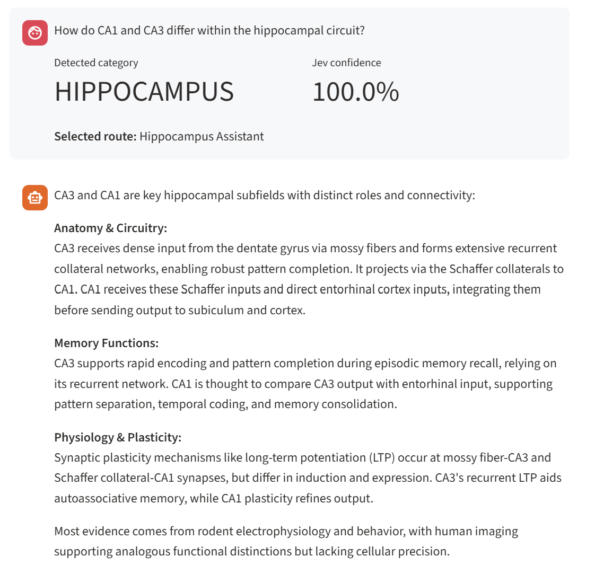
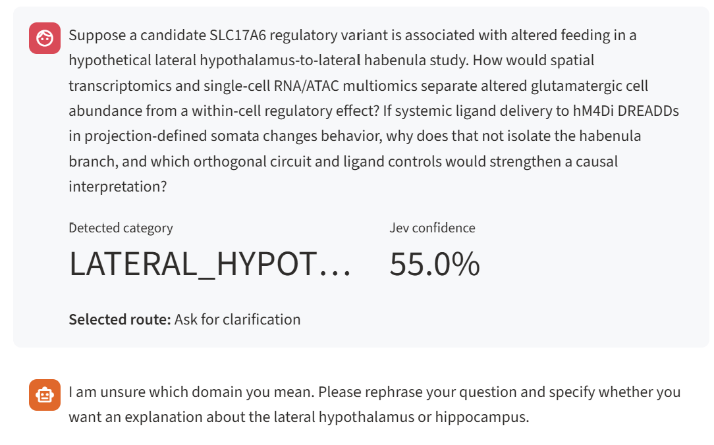
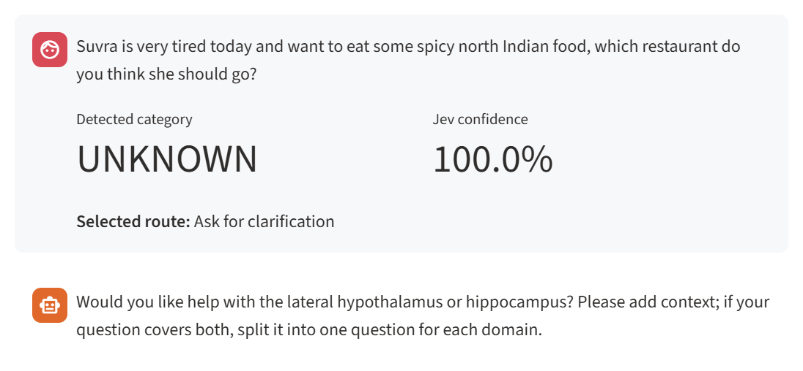

## Smart Question Router

Meet Suvra's simplest "Neuroscience Oracle Bot" that can make tough decision!

`Question → Jev classification → Python triage → Domain-specific LLM answer`

Jev returns a category and confidence; deterministic rules choose a route;
one OpenAI model answers using the selected region's system prompt.

## Run locally

Requires Python 3.12+ and [uv](https://docs.astral.sh/uv/getting-started/installation/).

```powershell
uv sync --locked
Copy-Item .env.example .env  # Skip if .env already exists
```

Set `TYPESAFE_API_KEY` and `OPENAI_API_KEY` in `.env`.
Get keys from [TypeSafe](https://console.typesafe.ai/) and
[OpenAI](https://platform.openai.com/api-keys). Keep `.env` private.

```powershell
uv run --locked streamlit run app.py
```

Defaults: `jev-1.14.0` and `gpt-4.1-mini`; configurable in `.env`.

## Behavior

- Displays category, confidence, route, and answer.
- Routes known categories at confidence **≥ 0.70**; otherwise asks for clarification.
- Mixed-region and out-of-scope questions also request clarification.
- Uses the last **three successful exchanges** for follow-ups; excludes API failures.
- Keeps chat in the current session. **New chat** clears it.

## Test and evaluate

```powershell
uv run --locked pytest              # Offline; no API keys needed
uv run --locked python evaluate.py  # 28 billable Jev calls
```

The **28-question dataset** includes four advanced questions per region on omics,
gene variants, projections, and DREADDs. Hypothetical mechanisms are labeled.

Live evaluation saves classification and routing accuracy to
`evaluation-results.json`. API errors count as failures; answer quality is not
graded. Jev confidence is not measured accuracy.

## Personal opinion

| Positive | Negative | Confused |
| --- | --- | --- |
|  |  |  |
| A clear question routes successfully. | A detailed scientific question gets stalled. | A food request gets a neuroscience follow-up. |

For simple fact retrieval and reranking, my instinct is to improve prompting before
adding another agent. I'll keep sharing my experience as I push this model toward
scalable systems and tougher scientific decisions. Can better prompts close the
gap, or do we need a better model for scientific decision-making?
